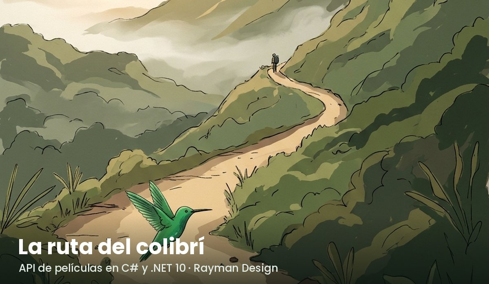
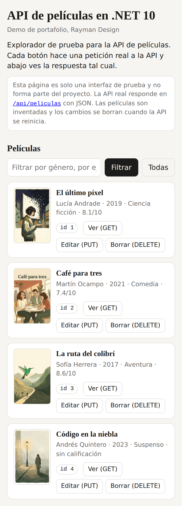
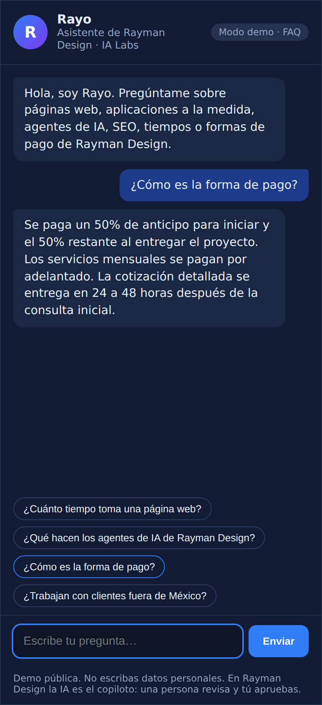

# Portafolio de demos de Rayman Design

Este repositorio reúne aplicaciones de demostración hechas en Rayman Design para mostrar cómo trabajamos el código: estructura ordenada, validación de datos, pruebas y documentación en español. Son proyectos de demostración y práctica, **no trabajos de clientes**, y todos los datos que usan son inventados o vienen del contenido público de [raymandesign.com](https://www.raymandesign.com).

## Demos

| Demo | Tecnología | Qué muestra |
|---|---|---|
| [API de películas](peliculas-api/) | C#, ASP.NET Core, .NET 10 | API REST con CRUD, filtro y validación en español |
| [Rayo, chatbot de preguntas frecuentes](rayo-chatbot-faq/) | PHP, JavaScript, HTML y CSS | Asistente web que responde con la FAQ pública, con modo de IA opcional |

### API de películas en .NET 10

Una API REST para un catálogo de películas: listar, filtrar por género, consultar, crear, actualizar y borrar. Valida los datos y responde los errores en español, con los códigos HTTP correctos (200, 201, 204, 400 y 404). Guarda los datos en memoria, así que al reiniciarla vuelve a las películas de ejemplo.

Incluye una guía paso a paso del código y un explorador de prueba: una página sencilla con botones para probar la API desde el navegador. En el explorador, cada película sale con su póster, su título, el director, el año, el género y la calificación. Los pósters son ilustraciones originales creadas para esta demo. Ese explorador es solo una interfaz de demostración, no un panel de administración.

  

### Rayo, chatbot de preguntas frecuentes

Rayo es el asistente de Rayman Design. En modo demo responde con las preguntas frecuentes públicas del sitio, sin IA en vivo y sin costo. Trae un modo con Gemini (Google AI Studio) que está programado pero apagado por defecto, y que solo se activa con una llave propia guardada en el servidor.

Cuida lo básico de una demo pública: límites de uso por visitante y por día, bloqueo de correos y teléfonos para que nadie comparta datos personales, y la llave nunca llega al navegador.

  

## Cómo probarlas

Cada carpeta tiene su propio README con los requisitos y los pasos:

- **API de películas:** necesita el SDK de .NET 10. Se arranca con `dotnet run` dentro de `peliculas-api`.
- **Rayo:** necesita PHP 7.4 o más reciente con cURL y mbstring. Se puede probar en local con `php -S 127.0.0.1:8088 -t public` dentro de `rayo-chatbot-faq`.

## Qué se probó

- **API de películas:** compila sin advertencias con el SDK 10.0.115 en Linux, y se probaron todos sus endpoints con la API corriendo. No se probó en Windows ni en macOS.
- **Rayo:** pasa sus 41 pruebas sin conexión (`php tests/run_tests.php`) y la prueba de punta a punta (`bash tests/http_smoke.sh`), que usa un servidor falso en lugar de Google. No se probó con una llamada real a Gemini.

## Sobre las versiones en vivo

Este repositorio publica el código, no las aplicaciones funcionando. GitHub Pages solo sirve páginas estáticas, así que no puede ejecutar la API en .NET ni el PHP de Rayo. Para verlas en vivo hay que correrlas en local o en un servidor que soporte .NET o PHP.

## Contacto

Rayman Design: [raymandesign.com](https://www.raymandesign.com) · [Contáctenos](https://www.raymandesign.com/contactenos/)
