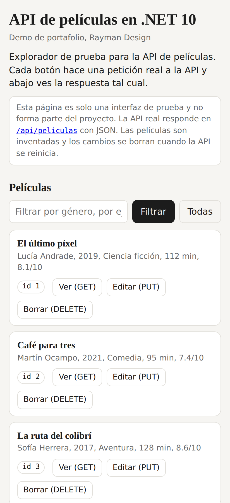

# API de películas en C# y .NET

Una API REST sencilla para administrar un catálogo de películas: listar, consultar, crear, actualizar y borrar (CRUD). Es un proyecto demostrativo de Rayman Design, hecho para practicar .NET y mostrar en el portafolio cómo se arma una API ordenada.

Todas las películas son **inventadas**. No usa APIs externas, imágenes ni datos con licencia de terceros.

Para entender el código línea por línea, lee **GUIA-PASO-A-PASO.md**. Este archivo es solo para arrancarlo y probarlo.

## Qué necesitas

- El **SDK de .NET 10** (es la versión LTS, con soporte hasta noviembre de 2028). Se descarga gratis en https://dotnet.microsoft.com/en-us/download/dotnet/10.0 para Windows, macOS o Linux.
- Un editor. Sirven Visual Studio Code (con la extensión C# Dev Kit), Visual Studio o Rider.
- Opcional: la extensión **REST Client** de VS Code para usar el archivo `PeliculasApi.http`, o Postman.

Para confirmar que el SDK quedó instalado, abre una terminal y escribe:

```bash
dotnet --version
```

Debe salir un número que empiece por 10.

## Cómo arrancarlo

1. Clona este repositorio y entra a la carpeta `peliculas-api` desde la terminal.
2. Compila el proyecto:

   ```bash
   dotnet build
   ```

3. Arranca la API:

   ```bash
   dotnet run
   ```

4. Cuando veas `Now listening on: http://localhost:5080`, la API ya está lista.
5. Abre http://localhost:5080 en el navegador. Debe salir un mensaje de bienvenida.
6. Para apagarla, presiona `Ctrl + C` en la terminal.

Los datos viven en memoria: cada vez que apagas y prendes la API, vuelve a las cuatro películas de ejemplo.

## Endpoints

| Método | Ruta | Qué hace | Respuestas |
|---|---|---|---|
| GET | `/api/peliculas` | Lista todas | 200 |
| GET | `/api/peliculas?genero=Comedia` | Filtra por género | 200 |
| GET | `/api/peliculas/{id}` | Trae una | 200, 404 |
| POST | `/api/peliculas` | Crea una | 201, 400 |
| PUT | `/api/peliculas/{id}` | Reemplaza una | 200, 400, 404 |
| DELETE | `/api/peliculas/{id}` | Borra una | 204, 404 |

## Ejemplos con curl

Estos comandos funcionan en Linux, macOS y en Git Bash de Windows. En PowerShell, cambia `curl` por `curl.exe`; si el JSON da problemas por las comillas, usa mejor el archivo `PeliculasApi.http` o Postman.

Listar todas:

```bash
curl http://localhost:5080/api/peliculas
```

Filtrar por género (no importa si va en mayúsculas o minúsculas):

```bash
curl "http://localhost:5080/api/peliculas?genero=comedia"
```

Traer la película 1:

```bash
curl http://localhost:5080/api/peliculas/1
```

Crear una película (con `-i` ves también el código 201 y el encabezado Location):

```bash
curl -i -X POST http://localhost:5080/api/peliculas \
  -H "Content-Type: application/json" \
  -d '{"titulo":"Noches de Papantla","director":"Elena Vargas","anio":2024,"genero":"Drama","duracionMinutos":101,"calificacion":7.9}'
```

Actualizar la película 2:

```bash
curl -i -X PUT http://localhost:5080/api/peliculas/2 \
  -H "Content-Type: application/json" \
  -d '{"titulo":"Café para cuatro","director":"Martín Ocampo","anio":2022,"genero":"Comedia","duracionMinutos":99,"calificacion":7.8}'
```

Borrar la película 4:

```bash
curl -i -X DELETE http://localhost:5080/api/peliculas/4
```

Probar la validación (debe responder 400 con la lista de errores):

```bash
curl -i -X POST http://localhost:5080/api/peliculas \
  -H "Content-Type: application/json" \
  -d '{"titulo":"","director":"Nadie","anio":1500,"genero":"Drama","duracionMinutos":0,"calificacion":15}'
```

## Reglas de validación

- **titulo**: obligatorio, hasta 200 caracteres.
- **director**: obligatorio, hasta 100 caracteres.
- **anio**: entre 1900 y 2100.
- **genero**: obligatorio, hasta 50 caracteres.
- **duracionMinutos**: entre 1 y 600.
- **calificacion**: opcional; si viene, entre 0 y 10.

El `id` nunca lo manda el cliente: lo asigna la API.

## Estructura del proyecto

```text
peliculas-api/
├── Program.cs                      Arranque: registra servicios y rutas
├── Modelos/Pelicula.cs             Cómo es una película (lo que guardamos)
├── Dtos/PeliculaEntradaDto.cs      Lo que acepta la API y sus reglas
├── Repositorios/
│   ├── IPeliculaRepositorio.cs     El contrato: qué se puede hacer
│   └── PeliculaRepositorioEnMemoria.cs  Cómo se hace (lista en memoria)
├── Controladores/PeliculasController.cs  Los endpoints
├── PeliculasApi.http               Peticiones listas para probar
├── Properties/launchSettings.json  Puerto 5080
├── appsettings.json                Configuración de logs
└── PeliculasApi.csproj             Archivo del proyecto (.NET 10)
```

El recorrido de una petición es: **Cliente → Controlador → Repositorio → Lista en memoria**, y la respuesta vuelve por el mismo camino.

## Qué se probó

Se compiló con el SDK 10.0.115 en Linux (Ubuntu), sin advertencias ni errores, y se probaron todos los endpoints con curl contra la API corriendo: listar, filtrar, consultar, 404 por id inexistente, crear con 201 y Location, validación con 400, actualizar, borrar con 204 y volver a borrar con 404. No se probó en Windows ni en macOS, ni con Visual Studio.

## Limitaciones conocidas

- Los datos se pierden al apagar la API (no hay base de datos).
- No tiene autenticación: cualquiera que llegue a la API puede crear o borrar.
- No tiene paginación; para una lista corta no hace falta.
- Si mandas un JSON roto o un texto donde va un número, .NET responde 400 pero con mensajes en inglés, porque esos los genera el propio framework.
- No tiene documentación Swagger/OpenAPI ni pruebas automáticas. La guía explica cómo agregarlas como siguiente paso.

## Explorador de prueba

La carpeta `explorador-de-prueba/` trae una página sencilla con botones para probar la API desde el navegador, más un pequeño servidor en Python que la sirve y reenvía las peticiones a la API. Es solo una interfaz de demostración, no un panel de administración de producción, y no forma parte del proyecto .NET: la API responde en JSON por sí sola.

Para usarla, con la API corriendo en el puerto 5080:

```bash
cd explorador-de-prueba
python3 proxy.py
```

Y abre http://localhost:8080/explorador en el navegador.



## Qué demuestra

Una API REST en .NET con una estructura ordenada (controlador, repositorio, DTO y validación) y con códigos HTTP correctos. Es un proyecto de demostración y aprendizaje, no un trabajo para un cliente.
