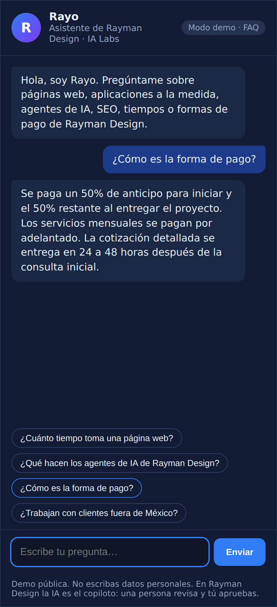

# Rayo, chatbot de preguntas frecuentes de Rayman Design

Rayo es un asistente web que responde preguntas sobre Rayman Design con las preguntas frecuentes públicas de [raymandesign.com](https://www.raymandesign.com). Es una demo para la sección IA Labs del sitio: en modo demo funciona sin IA en vivo, sin llamar a Google y sin costo.

<p align="center">
  
</p>

## Cómo funciona

- **Modo demo (por defecto):** busca la pregunta en `app/data/faq.json` y responde con la entrada que mejor coincide. Muestra preguntas sugeridas para empezar.
- **Modo con IA (opcional):** usa Gemini por la API de Google AI Studio, con la FAQ como única fuente. Solo se activa si en `config.php` se pone `'mode' => 'live'`, se marca `'free_tier_verified' => true` con la fecha, y hay una llave guardada fuera de la carpeta pública. Si falta cualquiera de esas cosas, se queda en modo demo.

La FAQ es una copia del contenido público del sitio revisado el 28 de octubre de 2026. Los precios que menciona son los publicados en esa fecha y pueden cambiar.

## Estructura

```text
rayo-chatbot-faq/
├── public/                 Lo que se publica en el sitio
│   ├── index.html          La página del chat
│   ├── rayo.css            Estilos
│   ├── rayo.js             Lógica del chat en el navegador
│   └── api/chat.php        Punto de entrada del servidor
├── app/                    Va fuera de la carpeta pública del hosting
│   ├── lib/RayoChat.php    Lógica: FAQ, límites, filtros y llamada a Gemini
│   ├── data/faq.json       Preguntas frecuentes públicas
│   ├── config.example.php  Configuración de ejemplo, sin llaves
│   └── .htaccess           Bloquea el acceso si la carpeta queda expuesta
└── tests/                  Pruebas que no se conectan a Google
```

## Cómo probarlo en local

Necesita PHP 7.4 o más reciente con cURL y mbstring.

```bash
cd rayo-chatbot-faq
php -S 127.0.0.1:8088 -t public
```

Y abre http://127.0.0.1:8088 en el navegador. Si la página dice "Origen no permitido", agrega tu dirección local a `allowed_origins` en una copia `app/config.php`, o déjala vacía mientras pruebas.

Para correr las pruebas:

```bash
php tests/run_tests.php
bash tests/http_smoke.sh
```

## Cómo instalarlo en un hosting con cPanel

1. Sube la carpeta `app/` fuera de `public_html`, por ejemplo a `/home/USUARIO/rayo-app/`.
2. Sube el contenido de `public/` a una carpeta del sitio, por ejemplo `public_html/ia-labs/rayo/`.
3. Indica dónde está `app/`: con la variable de entorno `RAYO_APP_DIR`, o cambiando la línea de `$APP_DIR` en `api/chat.php`.
4. Copia `app/config.example.php` como `app/config.php`, cambia `ip_salt` por una frase propia y revisa que `storage_dir` se pueda escribir.

## Protecciones incluidas

- La llave de Gemini solo vive en el servidor (variable de entorno o archivo fuera de la carpeta pública). Nunca llega al navegador ni a las respuestas.
- Límites propios: preguntas de hasta 400 caracteres, respuestas de hasta 350 tokens, y topes por visitante y por día (por defecto 4 por minuto y 25 al día por visitante, 200 al día en total).
- Si alguien escribe un correo, un teléfono o un número largo, la pregunta no se envía a Google y Rayo le pide no compartir datos personales.
- Rayo solo habla de Rayman Design con la FAQ, se niega a cambiar de personaje o revelar sus instrucciones, y no inventa precios ni plazos.
- Si se acaba el cupo gratuito, avisa al visitante que vuelva más tarde en lugar de cambiar a algo de pago.
- Las respuestas se muestran como texto plano y los errores con mensajes simples.

## Qué se probó

- 41 pruebas sin conexión, todas correctas: modo en vivo bloqueado sin verificar, respuestas de la FAQ, bloqueo de datos personales, topes de uso, manejo de cupo agotado, llave inválida y falta de conexión, y que la llave nunca salga.
- Prueba de punta a punta por HTTP, en modo demo y en modo en vivo contra un servidor falso que imita a Google.
- **Sin probar:** una llamada real a Gemini.

## Lo que falta para producción

- Cambiar el círculo con la "R" por la imagen oficial de Rayo (en `public/index.html` hay un comentario que indica dónde).
- Revisar que los precios de la FAQ sigan vigentes.
